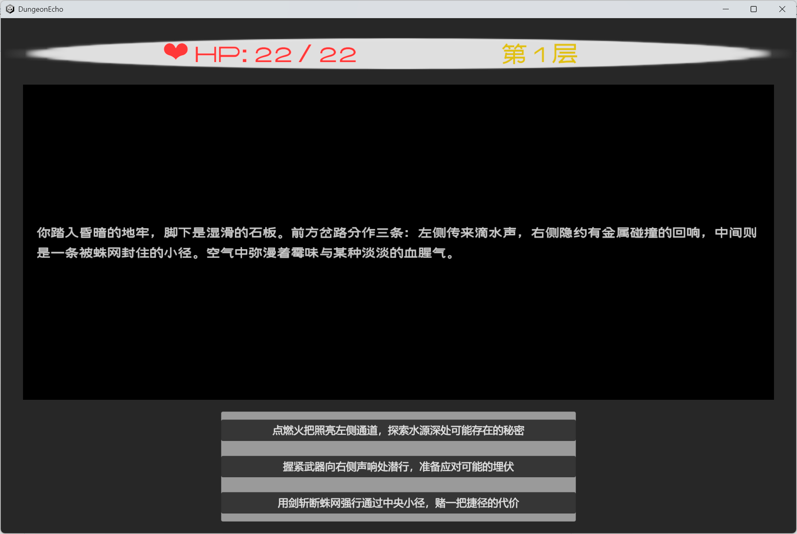
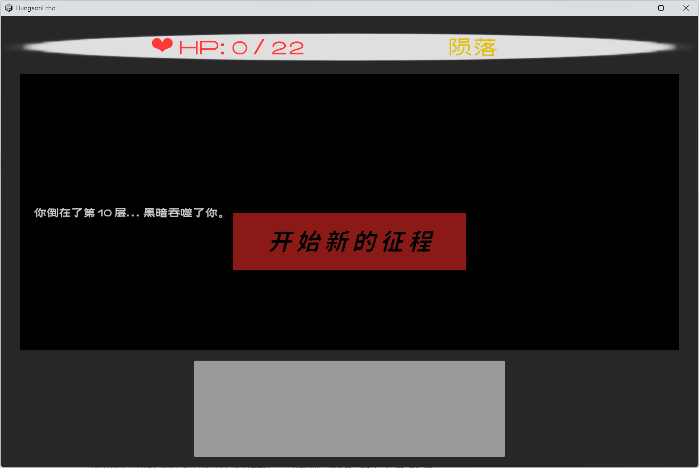
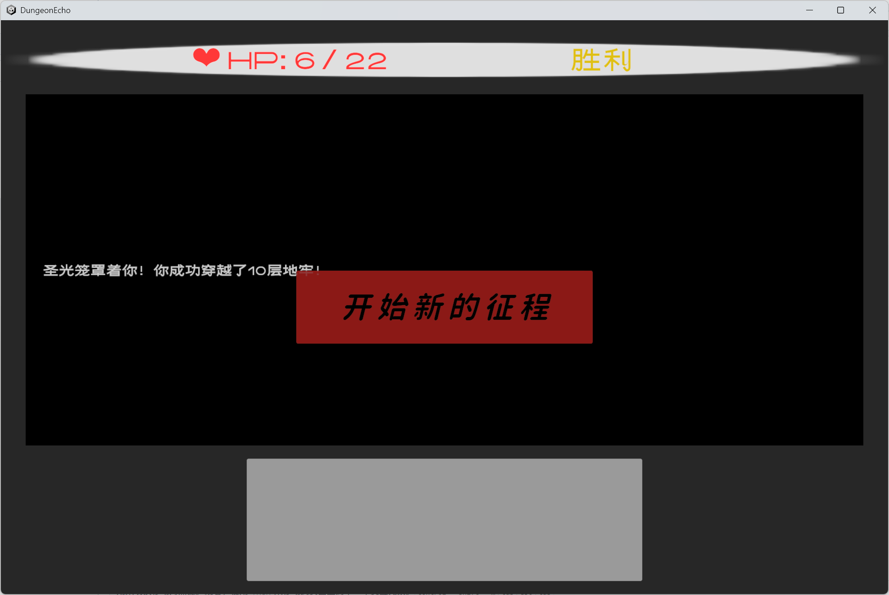

# 🗡️ Project Dungeon Echo

> **一句话描述**：一款由 DeepSeek 大模型驱动叙事、C# 控制数值的 Roguelike 地牢文字冒险游戏。

---

## 📖 项目背景

本项目旨在探索 **“生成式 AI 与确定性游戏规则”** 的混合架构。AI 负责生成无限不重复的沉浸式剧情，而传统的 C# 算法负责管理血量、层数和胜负判定，确保游戏平衡不会被 AI 的“幻觉”破坏。

---

## 🧠 核心架构亮点

1.  **三层解耦设计**：
    - **Unity 客户端**：负责 UI 渲染和玩家输入。
    - **Flask 网关**：独立部署在云服务器，隐藏 API Key，充当安全代理。
    - **DeepSeek API**：云端大模型引擎。
2.  **防御性编程**：对 AI 生成的 JSON 进行单引号转双引号清洗与格式校验，防止因模型输出异常导致游戏崩溃。
3.  **上下文记忆 (RAG)**：在 Unity 端维护 `List<string>` 历史记录，实现跨楼层剧情连贯性（例如：第 2 层受伤，第 5 层 AI 仍会提及）。
4.  **异步与流式体验**：基于 Unity 协程实现非阻塞网络请求，并内置加载动画与重试机制，应对高延迟网络环境。

---

## 🎮 游戏机制预览

- **目标**：穿越 10 层黑暗地牢，击败（或躲过）路上的未知生物。
- **数值规则**：**AI 只负责讲故事，C# 负责算账**。
  - 每层基础伤害 = `当前层数 × 1.1`。
  - 选择“冒险”会承受 0.3 倍伤害；选择“谨慎”仅承受 0.12 倍伤害。
- **失败条件**：血量归零或成功抵达第 10 层。

---

## 🚀 快速开始（如何试玩）

### 方式一：下载编译好的 EXE（推荐）
点击下方链接下载压缩包，解压后双击 `DungeonEcho.exe` 即可游玩（无需安装 Unity）。

🔗 **[点击下载 Windows 版本 v1.0]([https://pan.seamus.icu/games/DungeonEcho_v1.0.zip](https://github.com/Mr-Xylzhk/Project_Dungeon_Echo/releases/tag/v1.0.0))** *(注：若无法访问，请检查网络环境)*

### 方式二：本地源码运行
如果你要二次开发：
1. 克隆仓库：`git clone https://github.com/Mr-Xylzhk/Project_Dungeon_Echo.git`
2. 使用 Unity 2022.3 LTS 打开项目。
3. 确保修改 `DungeonManager.cs` 中的请求 URL 指向你自己的服务器接口。

---

## 🛠️ 技术栈明细

| 层级 | 技术选型 | 职责 |
| :--- | :--- | :--- |
| **客户端** | Unity 2022.3 / C# | UI 交互、协程网络请求、状态管理 |
| **网关层** | Python Flask + Requests | API 代理、Prompt 工程、JSON 清洗 |
| **AI 引擎** | DeepSeek Chat API | 动态叙事生成、选项构建 |
| **部署环境** | CentOS 8 + Nginx (宝塔面板) | HTTPS 反向代理、SSL 证书维护 |

---

## 📸 游戏截图

---

## 🔧 后续迭代计划

- [ ] 增加更多随机事件池（丰富 Prompt）。
- [ ] 优化移动端 UI 适配。
- [ ] 接入 SSE 流式响应实现“逐字打印”效果。

---

## 📄 许可证

[MIT](LICENSE) © 2026 Seamus
